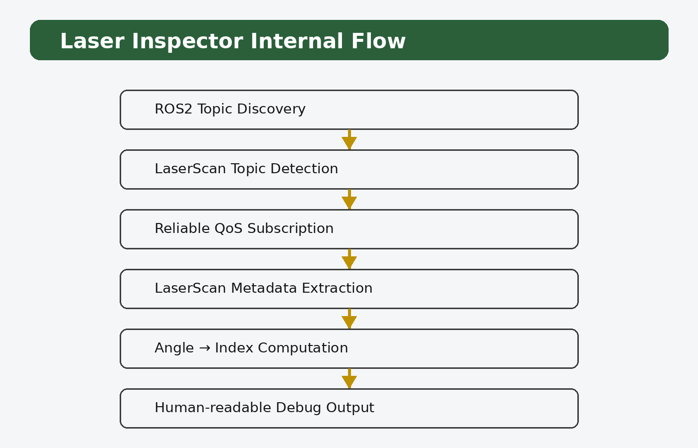
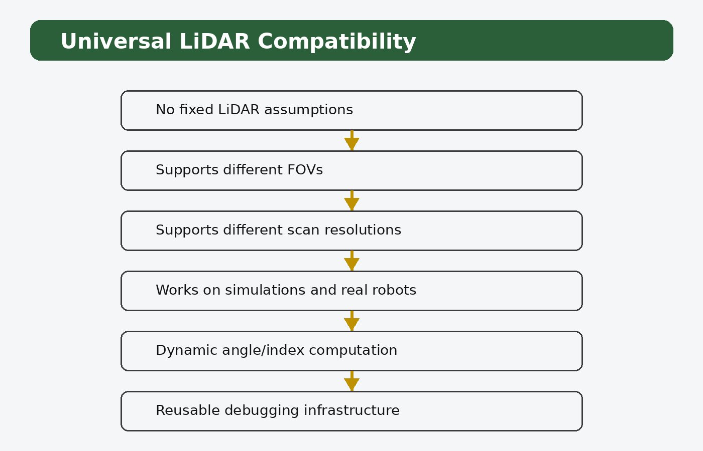
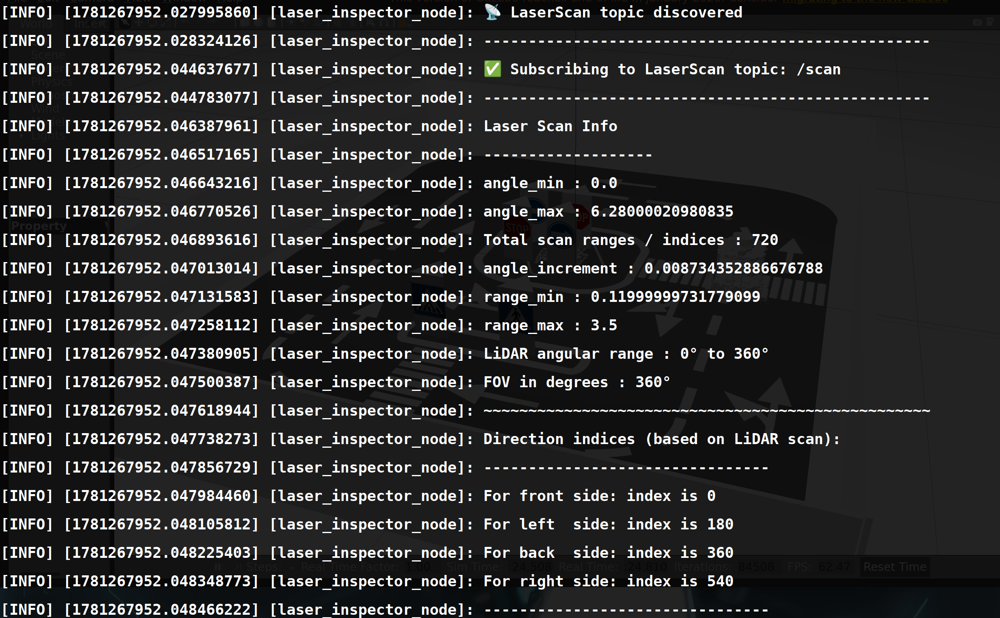
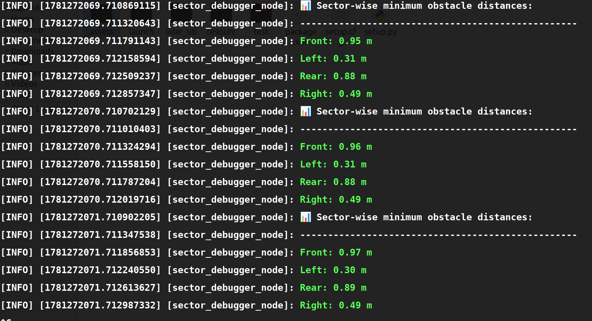

# ROS 2 LiDAR Utilities

Reusable ROS 2 tools for inspecting `sensor_msgs/msg/LaserScan` data, understanding scan geometry, converting angles to scan indices, and debugging obstacle distances by direction.

The goal is to give robotics engineers a lightweight way to inspect LiDAR data during robot bring-up, simulation, and navigation development—without tying the tools to one robot model or a fixed scan resolution.

**Tested in the user's workflow with Leo Rover and TurtleBot 3.** Compatibility with another robot depends on its ROS 2 setup and whether its LiDAR publishes a compatible `sensor_msgs/msg/LaserScan` topic.

## Tools at a glance

| Tool | Purpose |
|---|---|
| **Laser Inspector** | Discovers ROS 2 topics, identifies `LaserScan` data, and reports scan metadata and angle/index information. |
| **Sector Debugger** | Reports the minimum valid measured distance in four configurable-in-code directional sectors: Front, Left, Rear, and Right. |
| **Laser utilities** | Converts a requested angle in radians to the corresponding index in a `LaserScan.ranges` array using the scan's angular metadata. |
| **Angle utilities** | Converts degrees to radians and radians to degrees. |

## Why this package is useful

A `LaserScan` message is not just a list of distances. Its metadata describes the first measurement angle, the angular increment between measurements, and the sensor's range limits. The meaning of a range-array index therefore depends on the scan configuration.

These tools can help you:

- inspect a LiDAR topic when bringing up a new robot or simulator;
- understand the sensor's field of view (FoV) and angular resolution;
- relate a direction to a range-array index;
- observe how obstacle distances change as a robot or obstacle moves;
- debug wall-following, obstacle-avoidance, and navigation behaviour;
- reuse the same inspection workflow across robots with different scan configurations.

## Repository structure

```text
ros2-lidar-utils/
├── EVOLUTION.md
├── README.md
└── lidar_utils/
    ├── package.xml
    ├── setup.py
    ├── resource/
    ├── launch/
    │   ├── laser_inspector.launch.py
    │   └── sector_debugger.launch.py
    ├── assets/
    │   ├── diagrams/
    │   └── screenshots/
    └── lidar_utils/
        ├── __init__.py
        ├── angle_utils.py
        ├── laser_inspector.py
        ├── laser_utils.py
        └── sector_debugger.py
```

## 1. Laser Inspector

Laser Inspector is intended as an early diagnostic tool when integrating a LiDAR. It discovers available ROS 2 topics, looks for `LaserScan` data, subscribes using a compatible Quality of Service (QoS) profile, and prints human-readable scan information.

It reports scan metadata and calculates indices for requested directions when those directions fall within the scan's field of view. This helps engineers understand what the sensor can—and cannot—observe.

### Internal flow



### Universal scan geometry

The calculations use the incoming scan's angular metadata instead of assuming a fixed number of measurements or a fixed field of view. Different sensors can have different scan resolutions and angular coverage.



### Example output



## 2. Sector Debugger

Sector Debugger provides a continuously updated, directional summary of the scan. It divides the covered scan angles into four sectors:

- **Front**
- **Left**
- **Rear**
- **Right**

For each sector, it reports the minimum valid distance among the measurements assigned to that sector. A sector minimum is a useful quick indicator of the nearest return in that angular region.

### Example output



### Understanding field of view (FoV)

The tool works with the angular coverage present in the incoming `LaserScan`; it does not assume that every LiDAR provides a full 360° view.

| Sensor coverage | What to expect |
|---|---|
| **Approximately 360°** | The scan may cover Front, Left, Rear, and Right, depending on the message's angular limits. |
| **Approximately 180° forward-facing** | Front and some side angles may be available, but Rear is normally outside the scan's field of view. |
| **Narrow or partial FoV** | Only sectors or portions of sectors covered by the scan can be evaluated. |

For example, a robot such as TurtleBot 3 or Leo Rover can use this package if its ROS 2 LiDAR driver publishes a compatible `LaserScan` topic. The actual sector coverage depends on the specific sensor, driver configuration, and scan topic—not just the robot's name.

The tool distinguishes between a sector that is outside the sensor's field of view and a sector where no valid obstacle measurement is available. Interpret the output accordingly; `CLEAR` is not proof that the physical area is obstacle-free.

### Customizing sector boundaries

The default Front, Left, Rear, and Right sectors are practical starting points, not universal requirements. A robot may need narrower front coverage for forward obstacle avoidance, wider side sectors for wall following, or boundaries that reflect its sensor mounting and intended behaviour.

Sector boundaries are currently configured in the `sector_debugger.py` source code; they are not ROS 2 runtime parameters.

To customize them:

1. Open `lidar_utils/lidar_utils/sector_debugger.py`.
2. Find the sector-definition section and identify the angular limits assigned to Front, Left, Rear, and Right.
3. Adjust the boundaries to match your robot's needs, taking care not to create unintended gaps or overlapping sectors.
4. Save the file and rebuild the package if needed. With `--symlink-install`, Python source edits in the package are often picked up directly, but restart the running node to apply the changes.
5. Test with known obstacle positions and confirm that the reported sector changes as expected.

**Important:** ROS `LaserScan` angles are expressed in radians. In the standard ROS coordinate convention, angle zero points along the sensor frame's positive X axis and positive angles rotate counter-clockwise around positive Z. The sensor frame and mounting orientation still matter: confirm how the LiDAR is mounted on your robot before choosing sector boundaries.

## Installation

This repository contains a ROS 2 Python package nested inside the repository directory. Clone it into the `src` directory of a ROS 2 workspace.

```bash
mkdir -p ~/ros2_ws/src
cd ~/ros2_ws/src
git clone https://github.com/JcNavjot/ros2-lidar-utils.git
```

The examples below use ROS 2 Humble. Adjust the distribution if you use another supported ROS 2 distribution.

```bash
source /opt/ros/humble/setup.bash
cd ~/ros2_ws
colcon build --symlink-install
source install/setup.bash
```

If you already have a ROS 2 workspace, you can clone the repository into that workspace's `src` directory and build from that workspace root instead.

## Typical workflow: inspect a live robot or simulation

Use two terminals so the robot or simulation can keep publishing LiDAR data while you inspect it.

### Terminal 1 — start the robot or simulation

Start your normal robot bring-up or simulation launch file. For example, this may be your TurtleBot 3 or Leo Rover simulation command. The exact command depends on the robot and simulation package.

Confirm that the scan topic exists:

```bash
ros2 topic list
```

Find the LiDAR topic and check its message type:

```bash
ros2 topic info /your_scan_topic
```

Replace `/your_scan_topic` with the actual topic. The type should be `sensor_msgs/msg/LaserScan`.

### Terminal 2 — inspect the scan

First run Laser Inspector to understand the scan's field of view and angular metadata:

```bash
ros2 run lidar_utils laser_inspector
```

Then run Sector Debugger:

```bash
ros2 run lidar_utils sector_debugger
```

If the tools do not select or receive the expected scan topic, inspect the topic list and the node's topic-discovery output. Make sure the LiDAR publisher is running and that the topic uses `sensor_msgs/msg/LaserScan`.

### Observe changing distances

With the robot safely stationary, move a suitable test object slowly into one sector at a time while keeping clear of moving parts and avoiding contact with the robot. Watch the reported sector minimum change as the object moves closer or farther away. Repeat for the directions that the sensor can actually see.

This is a debugging workflow—not a substitute for a controlled test area, safe robot operation, or a validated collision-avoidance system.

## Running the tools

### Laser Inspector

```bash
ros2 run lidar_utils laser_inspector
```

Or use the launch file:

```bash
ros2 launch lidar_utils laser_inspector.launch.py
```

### Sector Debugger

```bash
ros2 run lidar_utils sector_debugger
```

Or use the launch file:

```bash
ros2 launch lidar_utils sector_debugger.launch.py
```

## Sector Debugger parameter

Sector Debugger provides a `print_interval` ROS 2 parameter to control how often it prints sector results.

Using the launch file:

```bash
ros2 launch lidar_utils sector_debugger.launch.py print_interval:=1.0
```

Or run the executable directly:

```bash
ros2 run lidar_utils sector_debugger --ros-args -p print_interval:=1.0
```

| Parameter | Purpose | Example |
|---|---|---|
| `print_interval` | Time between printed updates | `1.0` seconds |

Choose a positive interval suitable for your debugging session. This parameter controls print frequency; it does not change sector boundaries or distance calculations.

## Utility functions

### `angle_utils.py`

Provides degree-to-radian and radian-to-degree conversion helpers. These are useful when converting human-readable angles in degrees to the radians used in ROS messages and Python trigonometric functions.

### `laser_utils.py`

Provides angle-to-index conversion for a `LaserScan` message. The mapping uses the scan's `angle_min` and `angle_increment` and accounts for the scan's angular coverage.

The returned index identifies an element in `LaserScan.ranges`; it is not a distance measurement by itself. Read the range at that index and handle invalid readings appropriately.

## Troubleshooting

| Symptom | What to check |
|---|---|
| No scan data appears | Confirm the robot/simulation is running and the LiDAR topic is publishing. |
| The expected topic is missing | Check `ros2 topic list` and your robot's bring-up configuration. |
| Topic type is unexpected | Use `ros2 topic info /your_scan_topic`; these tools expect `sensor_msgs/msg/LaserScan`. |
| A sector is outside the FoV | Check the sensor's `angle_min`, `angle_max`, and mounting orientation. The sensor may not cover that direction. |
| A sector reports `CLEAR` | Check whether its readings are invalid, outside the sensor's usable range, or simply contain no detected return. Do not interpret this as a safety guarantee. |
| Distances appear in an unexpected sector | Verify the LiDAR frame orientation and the sector angular boundaries. |

## Important limitations

- These utilities inspect LiDAR messages; they do not replace a sensor driver.
- The available directions are limited by the sensor's actual field of view.
- Minimum sector distance is a debugging signal, not a complete obstacle-detection or collision-safety system.
- Sensor mounting, frame orientation, range limits, invalid measurements, and topic configuration can affect interpretation.
- Validate the behaviour on your specific robot and environment before using the output in autonomy logic.

## Development notes

`EVOLUTION.md` records the project's design decisions and development history.

## License

See the `license` field in `lidar_utils/package.xml` for the package's stated license.
